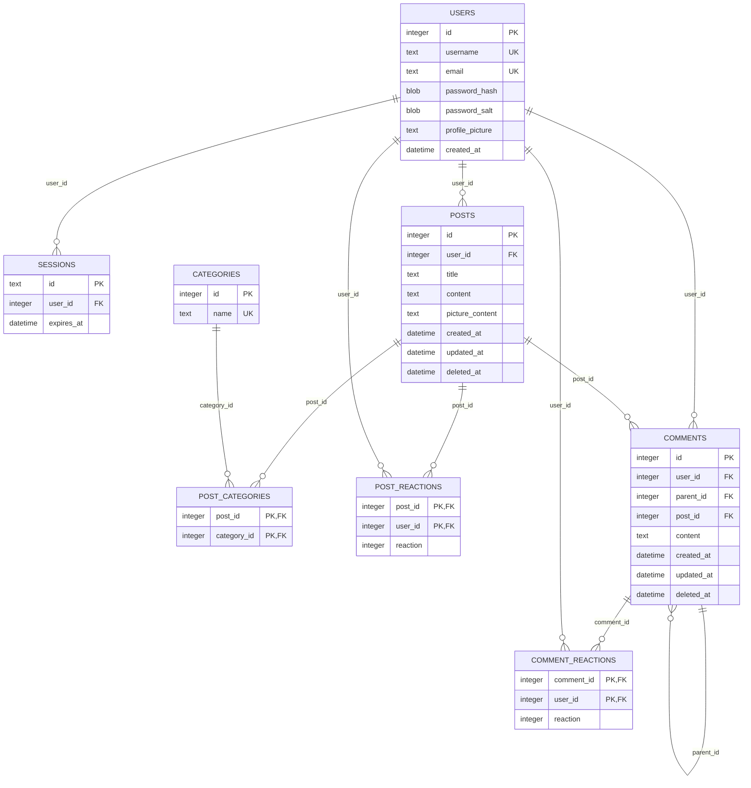

# 📚 Literary Lions Forum


## Overview

Literary Lions is a full-stack web forum built with **Go and SQLite** for readers to discuss books, share recommendations, and connect through literature.

Users can create posts, browse discussions by category, comment on posts, react to posts and comments, and explore user profiles. The application uses server-rendered HTML templates with CSS and JavaScript for interactive features.

The backend is organized into **handler, service, repository, middleware, and database layers** to separate HTTP handling, business logic, and data access.

---

## Features

- User registration, login, and logout
- Password hashing and cookie-based sessions
- Create, edit, and delete posts
- Browse posts and filter by literary category
- Search posts using SQLite FTS5 full-text search
- Comment on posts and reply to comments
- React to posts and comments
- User profiles with authored and liked posts
- Profile picture uploads
- Post image uploads or image URLs
- Custom error handling and error pages
- Responsive interface with JavaScript-powered interactions
- Automatic database schema initialization and demo data

---

## Prerequisites & Dependencies

Choose one way to run the application:

- **Locally:** Go 1.27.1 (as specified in `go.mod`), a C compiler (such as GCC), and CGO enabled.
- **With Docker:** Docker Engine with Docker Compose; Go and a C compiler do not need to be installed on your host if the Dockerfile provides the build environment.

**Make** is optional but recommended for the shortcuts below.

Key Go dependencies:
- SQLite driver: `github.com/mattn/go-sqlite3` (uses CGO, which is why local builds need a C compiler)
- Password hashing: `golang.org/x/crypto`

SQLite **FTS5** support is required for the application's full-text search. The supplied `make run` command enables it with `-tags fts5`. Docker builds must also enable FTS5.

---

## Setup

### Clone the Repository

```bash
git clone https://github.com/Afarmo/forum.git
cd forum
```

### Install Dependencies

```bash
go mod download
```

### Run Locally

```bash
make run
```

Equivalent Go command:

```bash
go run -tags fts5 ./cmd
```

Open your browser at:

**http://localhost:8080**

The application initializes `forum.db` and its schema on startup, then seeds categories and demonstration content when appropriate.

> **Note:** Use `-tags fts5` when running or building locally so SQLite full-text search is available.

### Run with Docker

From the repository root, build the image and start the forum:

```bash
make build
```

Or without Make:

```bash
docker compose up --build -d
```

Open **http://localhost:8080**. The Compose configuration publishes port `8080` and mounts the SQLite database and uploaded image directories so they can persist outside the container.

To inspect logs or stop the application:

```bash
make logs
make down
```

You can also use `docker compose logs -f` and `docker compose down` directly. For subsequent starts without rebuilding, use `make up`.

**Database persistence:** The Compose configuration bind-mounts `./forum.db`. Make sure this path is a database file rather than a directory before starting. If necessary, create it with `touch forum.db`. Uploaded images are also mounted so they survive container recreation.

### Demo Accounts

The included seed data creates example users such as `alice`, `bob`, and `carol` with the shared password `password123`.

These accounts are intended **only for local demonstration**.

---

## Usage

### Browse Discussions

Visit `/` to see the forum feed. Browse categories or use the search interface to discover posts.

### Create a Post

Register or log in, then use the post creation interface to write a title, content, and choose a category. Posts can also include an uploaded image or an image URL.

### Interact with Posts

Open a post to read its discussion, leave comments, reply to comments, or react. Authentication is required for posting, commenting, and reacting.

### User Profiles

Visit a user's profile to see their posts and liked posts. Logged-in users can upload a profile picture.

---

## Routes

### Public Routes

| Method | Route | Description |
|--------|-------|-------------|
| GET | `/` | Display the forum home page |
| GET | `/posts` | Browse posts |
| GET | `/posts/{id}` | View a post |
| GET | `/search?query={text}` | Search posts |
| GET | `/users/{id}` | View a user profile |
| GET | `/users/{id}/posts` | View posts by a user |
| GET | `/users/{id}/categories` | View categories associated with a user |
| GET | `/categories` | Retrieve categories |
| POST | `/register` | Register a user |
| POST | `/login` | Log in |
| GET | `/logout` | Log out |

### Authenticated Routes

| Method | Route | Description |
|--------|-------|-------------|
| POST | `/writePosts` | Create a post |
| POST | `/posts/{id}/update` | Update a post |
| POST | `/posts/{id}/delete` | Delete a post |
| POST | `/posts/{id}/comments` | Add a comment |
| POST | `/comments/{id}/delete` | Delete a comment |
| POST | `/posts/{id}/reaction` | React to a post |
| POST | `/posts/{postID}/comments/{commentID}/reaction` | React to a comment |
| POST | `/users/profile_picture` | Upload a profile picture |

---

## Architecture

The application separates responsibilities into distinct layers:

| Layer | Responsibility |
|-------|----------------|
| **Handlers** | Process HTTP requests and render templates or responses |
| **Services** | Coordinate application logic |
| **Repositories** | Query and update SQLite data |
| **Models** | Define application data structures |
| **Middleware** | Handle authentication, logging, and panic recovery |
| **Database** | Open SQLite, initialize the schema, and seed data |
| **Upload** | Validate image types, enforce file-size limits, and save uploads |
| **Web** | Store HTML templates and static assets |

This structure keeps SQL out of HTTP handlers and makes individual features easier to maintain.

---

## Database

The SQLite schema supports users, sessions, posts, categories, comments, reactions, and their relationships. Posts can belong to multiple categories; comments can have parent comments, enabling nested replies. Reactions are tracked separately for posts and comments.

The application uses **SQLite FTS5** for full-text post search. The local database file, `forum.db`, is excluded from version control.

### Entity-Relationship Diagram

The following is the full diagram maintained in [`schema.mmd`](schema.mmd). GitHub renders Mermaid diagrams directly in Markdown.



**Diagram notation:** `PK` means primary key, `FK` means foreign key, and `UK` means unique key. The `||--o{` connector represents a one-to-many relationship.

### Data and Uploads

- The application creates or initializes the SQLite database at startup.
- `internal/upload` checks uploaded image MIME types, enforces a 5 MiB limit, and assigns UUID filenames.
- Profile pictures and post images are stored under `internal/web/static/img/`.
- If saving an image fails, the helper removes the incomplete file; if the associated database operation fails, the handler removes the otherwise successful upload.
- External HTTP(S) image URLs are also supported for posts.


---

## Project Structure

```text
.
├── cmd/
│   └── main.go
├── internal/
│   ├── apperrors/
│   ├── auth/
│   ├── database/
│   │   ├── db.go
│   │   ├── schema.sql
│   │   └── seed.go
│   ├── handlers/
│   ├── middleware/
│   ├── models/
│   ├── repository/
│   ├── router/
│   │   └── router.go
│   ├── service/
│   ├── upload/
│   └── web/
│       ├── static/
│       │   ├── css/
│       │   ├── img/
│       │   └── js/
│       └── templates/
│           └── partials/
├── .github/
│   └── workflows/
├── Dockerfile
├── docker-compose.yml
├── Makefile
├── schema.mmd
├── go.mod
├── go.sum
└── README.md
```
